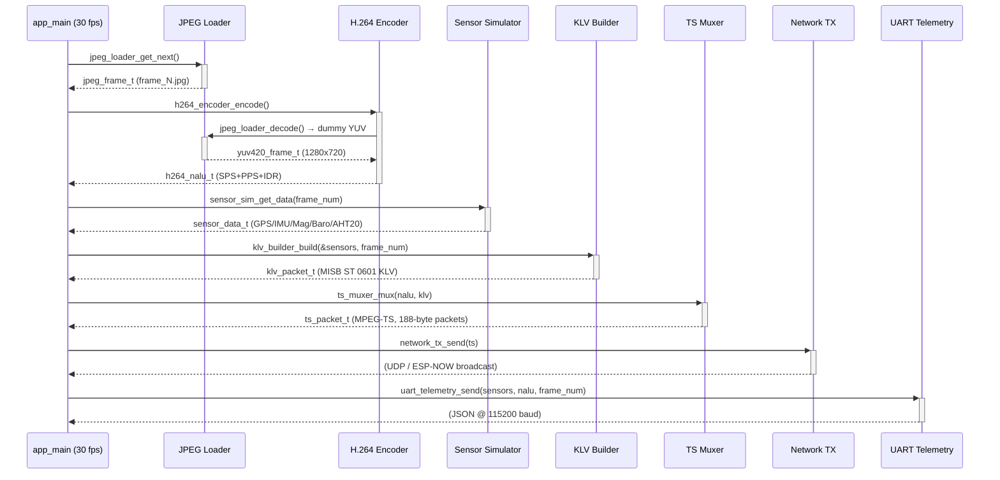
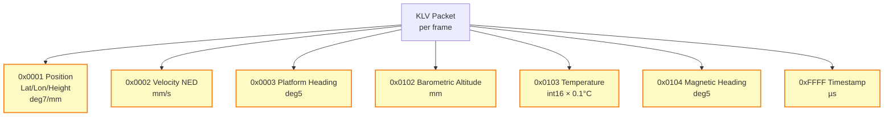
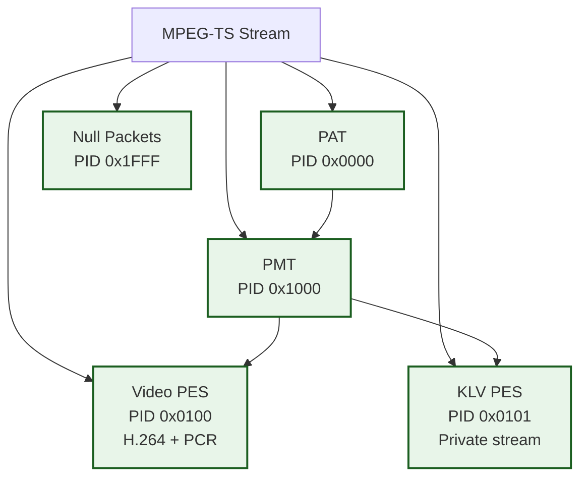
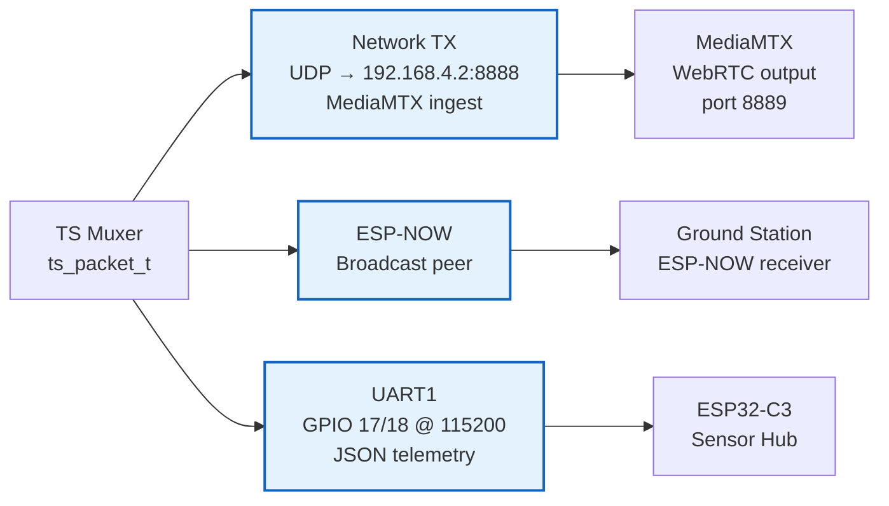
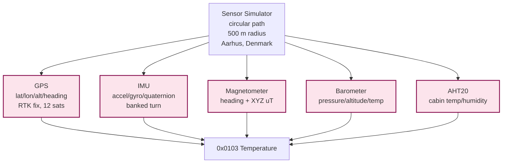

# STANAG S3 Simulator — Data Flow

Per-frame data flow through the 30 fps processing pipeline in `app_main()`.

## Pipeline Sequence



## Frame Timing Budget (33 ms @ 30 fps)

```mermaid
gantt
    title Per-Frame Budget (33 ms)
    dateFormat  ms
    axisFormat %Lms
    todayMarker off

    section Pipeline
    JPEG load & decode     : 0, 5ms
    H.264 encode           : 5, 15ms
    Sensor simulation      : 20, 2ms
    KLV metadata build     : 22, 3ms
    MPEG-TS mux            : 25, 4ms
    Network TX             : 29, 3ms
    UART telemetry         : 32, 1ms
```

## Data Structures

```mermaid
classDiagram
    class jpeg_frame_t {
        +uint8_t* data
        +size_t len
        +int width
        +int height
        +int index
    }

    class yuv420_frame_t {
        +uint8_t* y
        +uint8_t* u
        +uint8_t* v
        +int width
        +int height
        +uint64_t timestamp_us
    }

    class h264_nalu_t {
        +uint8_t* data
        +size_t len
        +int type
        +uint64_t timestamp_us
        +bool keyframe
    }

    class klv_packet_t {
        +uint8_t* data
        +size_t len
        +uint64_t timestamp_us
    }

    class ts_packet_t {
        +uint8_t* data
        +size_t count
        +size_t total_len
        +uint64_t timestamp_us
    }

    class sensor_data_t {
        +gps_data_t gps
        +imu_data_t imu
        +mag_data_t mag
        +baro_data_t baro
        +aht20_data_t aht20
    }

    jpeg_frame_t --> yuv420_frame_t : decode()
    sensor_data_t --> klv_packet_t : build()
    h264_nalu_t + klv_packet_t --> ts_packet_t : mux()
```

## KLV Metadata Tags (MISB ST 0601)



## MPEG-TS Packet Structure



## Output Destinations



## Sensor Simulation Model


