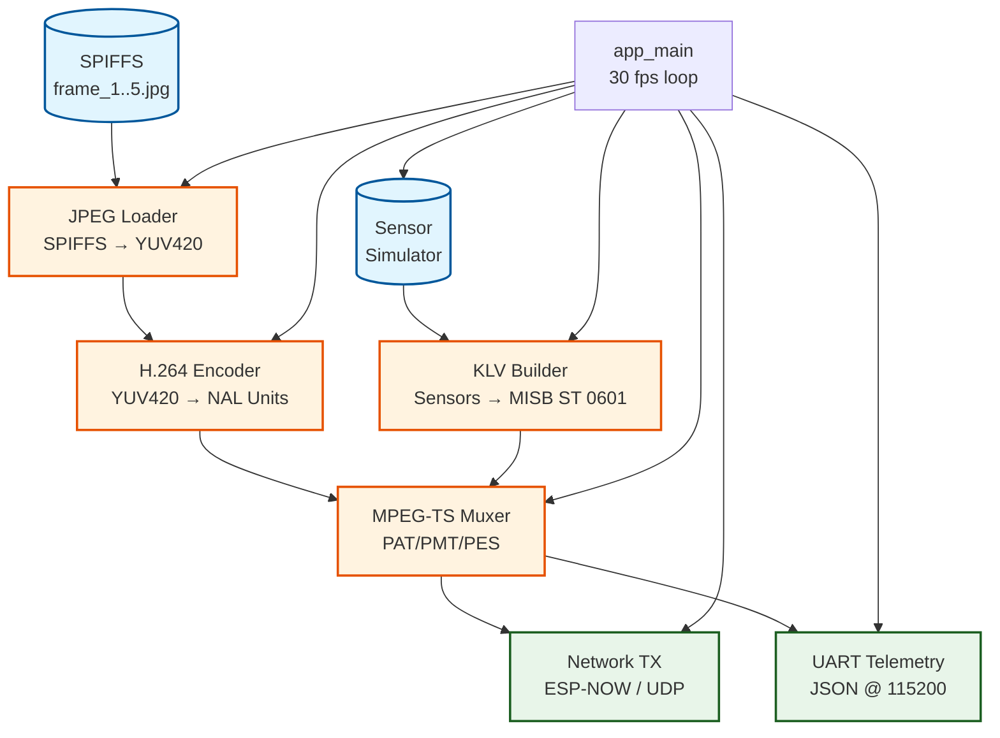
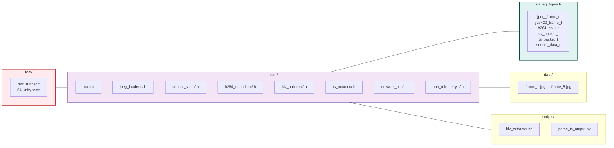
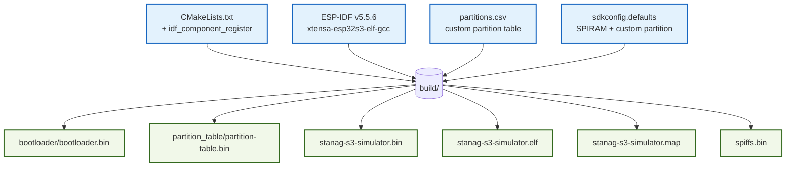

# STANAG S3 Simulator — Architecture Overview

ESP32-S3 firmware proof-of-concept that loops 5 JPEG frames from SPIFFS, simulates GPS/IMU/Magnetometer/Barometer/AHT20 sensor data, encodes to H.264 (software fallback), builds MISB ST 0601 KLV metadata, muxes into MPEG-TS, and streams via ESP-NOW/UDP for STANAG 4609 compliance testing.

## System Diagram



## Component Diagram



## Build Output



## Release Artifacts

| Artifact | Path | Purpose |
|---|---|---|
| `stanag-s3-simulator.bin` | `build/stanag-s3-simulator.bin` | Main application binary (flashed at 0x10000) |
| `bootloader.bin` | `build/bootloader/bootloader.bin` | Bootloader (flashed at 0x0) |
| `partition-table.bin` | `build/partition_table/partition-table.bin` | Partition table (flashed at 0x8000) |
| `spiffs.bin` | `build/spiffs.bin` | SPIFFS image with 5 JPEG frames (flashed at 0x110000) |
| `stanag-s3-simulator.elf` | `build/stanag-s3-simulator.elf` | ELF with symbols for debugging |
| `stanag-s3-simulator.map` | `build/stanag-s3-simulator.map` | Linker map file |

## Partition Table

```csv
# Name,   Type, SubType, Offset,  Size, Flags
nvs,      data, nvs,     0x9000,  0x6000,
phy_init, data, phy,     0xf000,  0x1000,
factory,  app,  factory, 0x10000, 0x100000,
spiffs,   data, spiffs,  0x110000, 0xEF000,
```

| Partition | Offset | Size | Purpose |
|---|---|---|---|
| `nvs` | 0x9000 | 24 KB | Non-volatile storage |
| `phy_init` | 0xF000 | 4 KB | PHY calibration data |
| `factory` | 0x10000 | 1 MB | Main application |
| `spiffs` | 0x110000 | ~960 KB | JPEG frames storage |

## Key Configuration

`sdkconfig.defaults`:

```kconfig
CONFIG_PARTITION_TABLE_CUSTOM=y   # Use partitions.csv instead of built-in
CONFIG_SPIRAM=y                    # Enable PSRAM for YUV frame buffers
```

## Quick Start

```bash
# In the container (ESP-IDF v5.5.6 available via EIM)
eim shell v5.5.6

cd firmware/stanag-s3-simulator
idf.py set-target esp32s3
idf.py build
idf.py flash monitor
```

## Related Documentation

- `README.md` — Quick start and feature list
- `MEDIAMTX.md` — Ground station setup (MediaMTX + WebRTC + Meta Quest)
- `mediamtx.yml` — MediaMTX configuration file
- `data/CMakeLists.txt` — SPIFFS image generation
- `test/CMakeLists.txt` — Unity test configuration
- `.woodpecker.yml` — Codeberg CI pipeline
